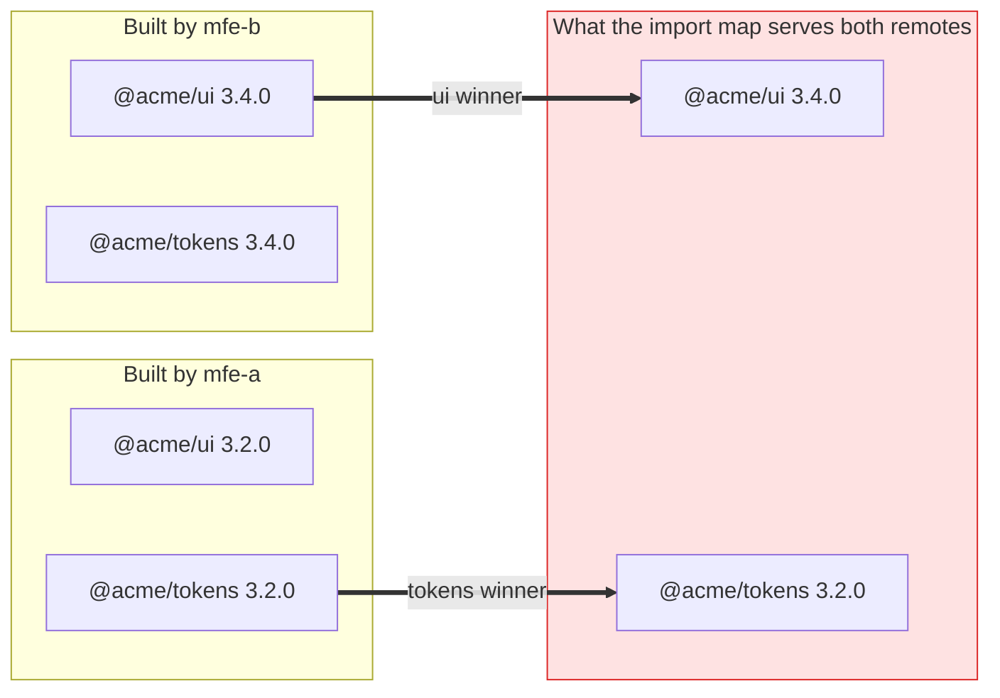
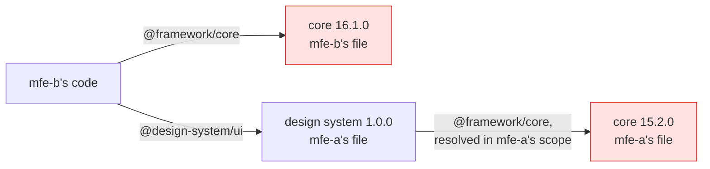
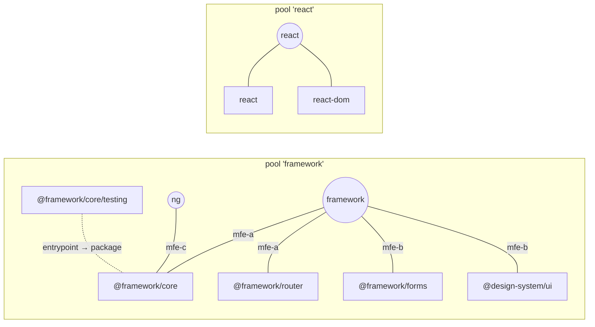
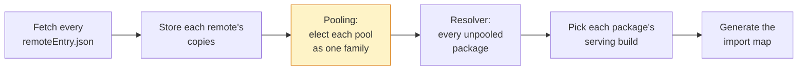
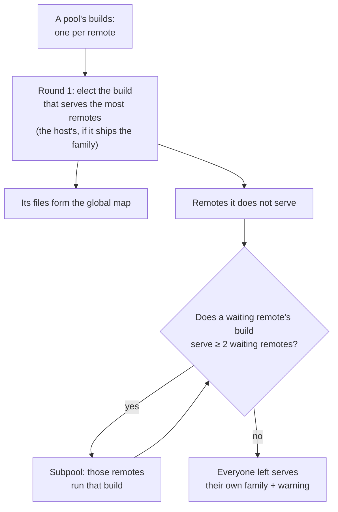
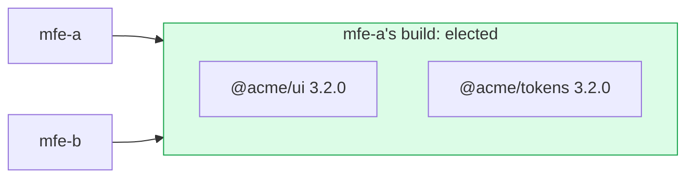
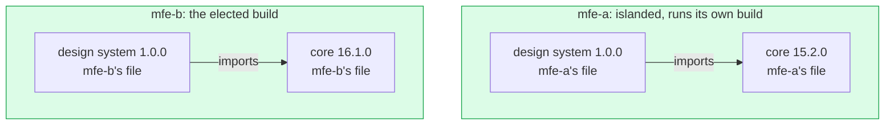
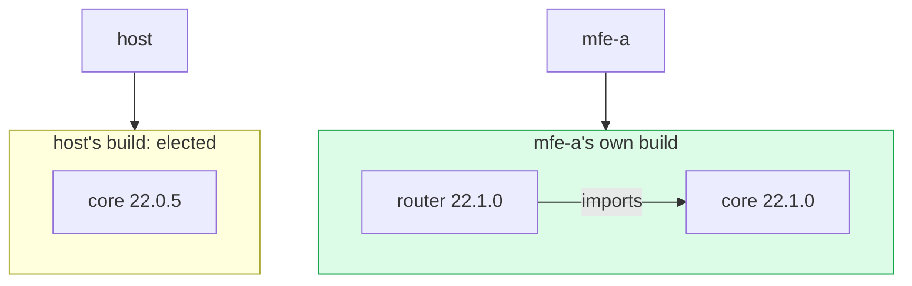
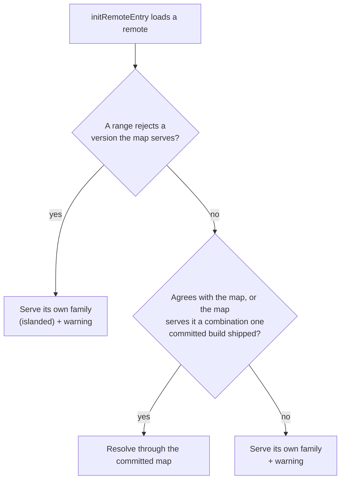

# Dependency Pooling

> Why a shared dependency family can end up assembled from builds that never shipped together, what pooling guarantees instead, and what that guarantee costs.

The [Version Resolver](version-resolver.md) resolves every shared external **independently**. That is the right default — it minimizes downloads, and for a flat dependency like `lodash` there is nothing to coordinate. But packages that ship as a **family** are not independent: `@angular/core` and `@angular/router`, `react` and `react-dom`, your own `@acme/ui` and `@acme/tokens`. Resolve those one at a time and a remote can end up running a combination nobody ever built.

**Pooling** is the opt-in feature that prevents that. You label the packages that belong together, and the orchestrator makes each remote take that whole group from **one build** — a shared one that shipped exactly that combination, or its own.

> **The promise.** Within a pool, every member a remote runs comes from a build that shipped them together.

## The problem, step by step

Two things go wrong without pooling. Both examples below show what the resolver actually produces for these inputs.

### 1. A family split across two builds

Two remotes share a design-system family. mfe-a pins its tokens tightly:

| Remote | `@acme/ui` | `@acme/tokens` |
| --- | --- | --- |
| mfe-a | `3.2.0`, accepts `^3.0.0` | `3.2.0`, accepts `~3.2.0` (`strictVersion: true`) |
| mfe-b | `3.4.0`, accepts `^3.0.0` | `3.4.0`, accepts `^3.0.0` |

Each remote's build is fine on its own: its `ui` and `tokens` were compiled and tested together.

The resolver then picks a winner **per package**, each on its own:

- **`@acme/tokens` → `3.2.0`.** mfe-a's `~3.2.0` rejects `3.4.0`, while mfe-b's `^3.0.0` accepts `3.2.0`. Picking `3.2.0` lets both remotes dedup.
- **`@acme/ui` → `3.4.0`.** Both ranges accept both versions, so the tie goes to the newest.

Each choice is optimal on its own. Together they hand **both** remotes a pair that exists in no build:



It usually works. When it doesn't, the failure surfaces as a missing export or a subtly wrong theme token, far from the version metadata that caused it.

The root cause is that declared ranges **under-state real coupling**. Angular publishes `^22.0.0` on its inter-package dependencies while `@angular/router@22.1.0` genuinely requires `@angular/core@22.1.0`. The remote entry cannot tell the orchestrator that; the range says the pair is fine.

### 2. A second framework runtime through a shared intermediary

The sharper hazard. A design system is compiled against the framework, and both are shared:

| Remote | `@framework/core` | `@design-system/ui` |
| --- | --- | --- |
| mfe-a | `15.2.0`, accepts `^15.0.0` | `1.0.0` |
| mfe-b | `16.1.0`, accepts `^16.0.0` | `1.0.0` |

The two `core` versions are incompatible, so the resolver shares `16.1.0` and gives mfe-a its own `15.2.0` in mfe-a's scope. The design system is `1.0.0` on both sides, so it is shared — and it happens to be published from mfe-a's copy.

Import map scopes are chosen by the URL of the **importing file**. The shared design system lives under mfe-a's URL, so its own `import '@framework/core'` resolves in mfe-a's scope:



mfe-b now runs **two framework runtimes**: two DI containers that cannot see each other, two copies of module-level state, two `instanceof` identities. No declared range was violated. The design system and the framework are different packages, resolved in different competitions. Had the design system been published from mfe-b's copy instead, mfe-a would be the one running both runtimes.

## Do you need it?

Pooling is inert until a remote labels a family. Reach for it when:

- **Yes** — you share a package family published from one monorepo (`@angular/*`, `@acme/*`) across remotes that **deploy independently**. This is the case it was built for: independent deploys are exactly what lets versions drift apart between members.
- **Yes** — you share an unscoped lockstep pair (`react` + `react-dom`, `vue` + `vue-router`).
- **Yes** — you share a design system or SDK that is itself compiled against a shared framework. That is the second example above.
- **Probably not** — all your remotes build from one repo at one commit and deploy in lockstep. They already agree. Pooling will find nothing to do and cost nothing, but it solves a problem you don't have.
- **No** — you share only flat, independent libraries. There is no family to keep coherent.

Symptoms worth checking against: two instances of a framework singleton, `instanceof` failing across an MFE boundary, a component library reading `undefined` from a peer's module state, or an import map where two members of one family resolve to different remotes.

## Enabling pooling

An external joins a pool through an optional `pool` label on a shared package in the remote's `federation.config.mjs`. It mirrors `shareScope` in shape. Core passes it through to `remoteEntry.json` untouched, and the build itself does nothing with it. See [Core — per-package options](../core/sharing.md#per-package-options).

> **Upgrading from 4.7.** Orchestrator 4.8.0 elects a pool's members together as one family, where 4.7 let the resolver pick each member's version and then checked the result. A pooled family's global version can therefore move — an older build wins when it serves more remotes — and the log lines changed (see [Diagnostics](#diagnostics)).

```js
// federation.config.mjs
import { withNativeFederation, share } from "@softarc/native-federation/config";

export default withNativeFederation({
  name: "team/mfe1",
  shared: share({
    react: { singleton: true, requiredVersion: "auto", pool: "react" },
    "react-dom": { singleton: true, requiredVersion: "auto", pool: "react" },
  }),
});
```

Which lands in the remote entry as:

```json
{
  "shared": [
    { "packageName": "react",     "singleton": true, "version": "18.3.1", "requiredVersion": "^18.0.0", "pool": "react" },
    { "packageName": "react-dom", "singleton": true, "version": "18.3.1", "requiredVersion": "^18.0.0", "pool": "react" }
  ]
}
```

Labelling every package of an npm scope with that scope (`@framework/core`, `@framework/common` → `framework`) is the usual way to pool a framework family. The design-system hazard is covered by labelling **across** scopes: give `@design-system/ui` the family's label, `framework`.

## How a pool is formed

**A pool is a name.** Every external labelled `framework`, by any remote, is in the `framework` pool. Formally the orchestrator draws a graph and each **connected group** is a pool:

- every shared external is a node, and so is every label;
- a remote that labels an external links the two;
- a secondary entrypoint is always linked to its package (`@framework/core/testing` → `@framework/core`), labelled or not. The package is the one [One build per package](version-resolver.md#one-build-per-package) groups it into, so a library served as its own [declared package](../core/configuration.md#declaring-mapping-packages) joins no sibling under the same npm name: a label on `@shared/components/table` pulls in no `@shared/components/collapse`.

For example, mfe-a labels `@framework/core` and `@framework/router` with `framework`, mfe-b labels `@framework/forms` and `@design-system/ui` with `framework`, mfe-c labels `@framework/core` with `ng`, and mfe-d labels `react` and `react-dom` with `react`:



Three consequences follow from the picture:

- **Remotes need not label the same members.** mfe-a's `core` + `router` and mfe-b's `forms` + `ui` are one pool because both use the label `framework`.
- **Different names that share an external merge.** mfe-c calls the family `ng`, but labels `@framework/core`, which is already in `framework`, so `ng` joins the same pool.
- **Entrypoints follow their package.** `@framework/core/testing` carries no label of its own and still joins, because a package and its entrypoints are one artefact. On its own, with no label in the group, that link forms no pool.

> A label that joins no other external is almost always a typo or a missing sibling. It is logged at `debug`.

**A pool is named after the label most of its copies declare**, with ties broken alphabetically. The pool above is named `framework`.

## Where pooling runs

Pooling is a step in the init pipeline, before the per-package resolver:



- **Pooling** elects the members of every pool together, and writes the verdicts the import map needs. The [Version Resolver](version-resolver.md) never sees a pooled external.
- **Re-election is per scope.** The moment one external in a scope changed (a remote was added, redeployed or removed), every pool of that scope is re-elected, so a verdict made for an earlier portfolio cannot outlive the condition that caused it.

When nothing in a scope is dirty — a warm init with no new remotes — pooling does no work there.

## How pooling decides

The unit pooling reasons about is a **build**: everything one remote ships in the pool, as `specifier → version`. A build is coherent by construction, because those files were compiled and tested together. So pooling only asks two things of a build:

- does it **serve** a remote — ship every entrypoint that remote imports, at versions the remote's `requiredVersion` accepts?
- does a remote **agree** with it — ship every specifier both have at the same version?

It never judges how "close" two version numbers look. Version arithmetic cannot carry the promise: a minor line is a convention each vendor picks.

For each pool:



1. **Round 1 elects the global map.** Every build is a candidate, ranked by: the newest build under [`profile.latestSharedExternal`](configuration.md#profile); then most remotes served; then most remotes that agree with it without being served; then the build the stored record already elected; then the newer build, then name. A host that ships the family is always round 1: its files are loaded anyway and cannot be repointed.
2. **Subpools.** Among the remotes round 1 does not serve, the build that serves the most of them — at least two — forms a **subpool**: those remotes run that build's files through their scopes. Rounds repeat until no build serves two.
3. **Extension.** A package the winner doesn't ship at all can still be published globally, when every remote that agrees with the winner and ships that package ships it at one version. A remote moves onto the global map only if one build shipped the exact combination it would resolve.
4. **Everyone left serves their own family**, from their own build, with a warning and the reason stored.

A remote off the global map takes **nothing** from it — not even a file at its own version, because that file's own imports would bind the global peers.

The examples from the start of this page, plus two more, show each outcome.

### The family split: one build wins

In the [first example](#1-a-family-split-across-two-builds), round 1 compares the two builds:

| Build | Serves mfe-a? | Serves mfe-b? | Remotes served |
| --- | --- | --- | --- |
| mfe-a's (`ui@3.2.0`, `tokens@3.2.0`) | ✓ its own | ✓ `^3.0.0` accepts both | **2** |
| mfe-b's (`ui@3.4.0`, `tokens@3.4.0`) | ✗ `~3.2.0` rejects `tokens@3.4.0` | ✓ its own | 1 |

mfe-a's build wins, and both remotes run it:



```json
{
  "imports": {
    "@acme/ui": "http://mfe-a/@acme/ui.js",
    "@acme/tokens": "http://mfe-a/@acme/tokens.js"
  }
}
```

The per-package resolver would have picked `ui@3.4.0`; electing the family moved it back to `3.2.0`, the version every range accepts. Two files were downloaded before, and two are downloaded now. Pooling logs nothing, because every remote is on the elected build.

Add a third remote, mfe-c, whose build happens to be `ui@3.4.0` with `tokens@3.2.0` (both `^3.0.0`). Its build serves all three remotes too, so it ties with mfe-a's, and the tie goes to the newer build: everyone runs mfe-c's pair. That pair _was_ built and tested together — by mfe-c.

### The transitive case: a remote is islanded

In the [second example](#2-a-second-framework-runtime-through-a-shared-intermediary), with `@framework/core` and `@design-system/ui` both labelled `framework`, each build serves only its own remote: `^15.0.0` rejects `core@16.1.0` and the other way round. The tie goes to the newer build, mfe-b's. mfe-a's range rejects a version of the elected build, so mfe-a is **islanded**: its entire family comes from its own build — including `@design-system/ui@1.0.0`, even though that version matches the shared one exactly.

That last part is the whole point, and the one thing the per-package resolver cannot do:



```json
{
  "imports": {
    "@framework/core": "http://mfe-b/@framework/core.js",
    "@design-system/ui": "http://mfe-b/@design-system/ui.js"
  },
  "scopes": {
    "http://mfe-a/": {
      "@framework/core": "http://mfe-a/@framework/core.js",
      "@design-system/ui": "http://mfe-a/@design-system/ui.js"
    }
  }
}
```

Each remote runs one framework runtime. mfe-a pays one extra download for the design system, and the log says so:

```
[__GLOBAL__][pool:framework] 'mfe-a' is islanded: its range rejects '@framework/core@16.1.0' of the elected build 'mfe-b'. All 2 of its entrypoints are scoped for it.
```

### A host pin: a remote serves its own family

The third example is a host that pins an older framework, and a remote that is one minor ahead:

| Participant | `@framework/core` | `@framework/router` |
| --- | --- | --- |
| host | `22.0.5` | — |
| mfe-a | `22.1.0`, accepts `^22.0.0` | `22.1.0`, accepts `^22.0.0` |

The host's build is round 1. Without pooling, mfe-a would run the host's `core@22.0.5` beside its own `router@22.1.0` — and `router@22.1.0` was built against `core@22.1.0`. With pooling, the host's build doesn't serve mfe-a (it has no `router`), and no other build serves two remotes, so mfe-a serves its own family:



```
[__GLOBAL__][pool:framework] 'mfe-a' serves its own family: no elected build offers every entrypoint it imports at a version it accepts (gap '@framework/router', closest 'host'). All 2 of its entrypoints are scoped for it.
```

The warning names the gap and the closest build: if the host shipped `@framework/router` too, its build would serve mfe-a.

### Two remotes ahead of the host: a subpool

Now let mfe-a **and** mfe-b both ship `core@22.1.0` with `router@22.1.0`. The host's build serves neither, but mfe-a's build serves both, so they form a **subpool** named after it. Both run mfe-a's files through their scopes, and the second framework runtime is downloaded once instead of twice:

```json
{
  "imports": {
    "@framework/core": "http://host/@framework/core.js"
  },
  "scopes": {
    "http://mfe-a/": {
      "@framework/core": "http://mfe-a/@framework/core.js",
      "@framework/router": "http://mfe-a/@framework/router.js"
    },
    "http://mfe-b/": {
      "@framework/core": "http://mfe-a/@framework/core.js",
      "@framework/router": "http://mfe-a/@framework/router.js"
    }
  }
}
```

Each subpool member still gets a warning, ending in where its copies now come from:

```
… 'mfe-a' serves its own family: … Its build serves subpool 'mfe-a': its 2 entrypoints and 1 other remote(s).
… 'mfe-b' serves its own family: … It runs in subpool 'mfe-a' for all 2 of its entrypoints.
```

### The rules that fall out of it

**All-or-nothing per remote.** A remote that cannot take every member it imports from one build runs its _whole_ family from a single other build. One member at the remote's own version beside another from a foreign build is precisely the combination nothing compiled.

**The consumer gives way, never the host.** The host's build is always elected when it ships the family. A remote whose range rejects the host's version is islanded, and one that imports an entrypoint the host lacks (`core/rxjs-interop`, say) runs on a subpool's or its own runtime. To keep such a remote on the host's runtime, the host must ship that entrypoint.

**Coherent per remote, not per page.** A remote on another build runs another framework instance. Rendering its components inside the host's tree, which shares DI with the host's instance, fails (Angular: `NG0203`). Keep remotes you compose into the host on the host's build: align their versions and ranges with the host's, and ship what they import in the host.

**Coverage is per entrypoint.** A build can ship every _member_ of a pool and still lack one secondary entrypoint a remote imports, and then it does not serve that remote. Inside a pool, a package therefore cannot be torn across two builds.

**Strict mode.** Under `strictExternalCompatibility` init throws when a `strictVersion` range rejects a version of the elected build — the same incompatibility the resolver refuses. A remote that only misses round 1 for **coverage** never throws: nothing about its versions is wrong.

## What it costs

> **Pooling chooses coherence first, then downloads.** Between two coherent placements it prefers, in order: with a host, more remotes on the host's runtime; fewer duplicate instances; fewer self-served copies; fewer builds.

Because the election maximises the remotes one build serves and then groups the rest into subpools, it can also _save_ downloads where per-package resolution split a family:

| Portfolio | Effect |
| --- | --- |
| Seven-remote production capture | Unchanged: 37 `@angular/*` files. |
| Eleven-remote drifted portfolio | `@angular/*` files the map can fetch drop from 75 to 63. |
| Warm init (nothing dirty) | Zero. Pooling does no work and writes nothing. |

Where it costs, it costs exactly where incoherence was: a remote that would have mixed builds downloads its own family. The escape hatch is to **not pool that family** (drop the `pool` label) — not a per-portfolio tuning knob.

## Declaring the coupling you actually have

Pooling exists to compensate for information the remote entry does not carry. You can carry some of it yourself.

**Tighten ranges where the real coupling is tighter.** Write `~22.0.6` rather than `^22.0.0` when that is the truth. A remote that disagrees with the elected build never takes a file from it anyway, so the placement is the same. What changes is _which verdict you see_: a range that rejects the elected build is reported as an island (`incompatible`) and refused under `strictExternalCompatibility` — a version problem with a name — while a coverage miss is a statement about what nobody built.

**Label the whole family.** A member left unlabelled pools only if some _other_ remote labels it, or as an entrypoint of a labelled package, and the failure is quiet: the member is still shared, just no longer coordinated with the family. A build emitting flat entries makes this easy to get wrong — `@framework/core` and `@framework/core/primitives/di` are two externals, and labelling only the first leaves the second relying on the package link rather than on your label.

**A label decides what a remote runs on its own build.** Pooled, a remote no build covers runs its whole family from its own build. Unlabelled, the fallback unit is the package alone ([one build per package](version-resolver.md#one-build-per-package)): the remote runs its own `@framework/core` while the shared `@framework/common` it also takes binds the shared one, so it runs two cores.

**One remote declaring a label is enough for the whole portfolio.** The label decides which externals form the pool, but the pool then operates on each member as a whole: every version, every remote. Remotes that never declared a `pool` label are still subject to the family's coherence rules. That is deliberate (one team can fix a portfolio it does not own), but worth knowing before adding a label.

> A coupling **no remote declares** — two externals no label connects — cannot be expressed. This is by design.

## Scope and dynamic init

Pooling applies to the **global scope** and to **named share scopes**. The [`strict` share scope](version-resolver.md#the-strict-share-scope) is never pooled — it exists precisely to let versions coexist.

Pooling also runs when a remote is added at runtime with `initRemoteEntry`. The import map is immutable once committed, so this pass holds **no election**: it judges only the newly loaded remote against the committed map, and every remote already running keeps exactly what it has.



Per pool, the loaded remote either resolves through the committed global map or serves its own family; it never joins a committed subpool.

**Membership comes from the committed record**, not from the entry being loaded. A remote loaded at runtime is subject to every pool the portfolio has — including one formed by another remote's `pool` label. Otherwise a remote loaded later is exactly the consumer that would bridge two builds the portfolio had deliberately pooled apart.

**The next init re-elects.** A load marks the loaded remote's pooled members dirty, so the next init re-elects their pools with the remote in it: the next page is the one a manifest listing that remote would have built. Under `strictExternalCompatibility` nothing is marked, and the next page keeps the load's verdicts.

## What pooling stores

Pooling's results live in the shared-externals record next to the verdicts they explain, so a tool reading the storage — for instance through [`globalThis.__NF_ORCHESTRATOR__`](configuration.md#storage-pointer) — does not have to re-derive them. Each field is omitted when it does not apply.

| Where | Field | Meaning | In the examples |
| --- | --- | --- | --- |
| `SharedExternal` | `poolName` | The pool this external resolves in, named as [above](#how-a-pool-is-formed). | `framework`, `acme` |
| `SharedExternal` | `poolWinner` | The build round 1 elected. A re-election on equal terms keeps it. | `mfe-b` in the second example, `host` in the third |
| `SharedVersionMeta` | `pool` | The `pool` label this remote declared — pooling's input, never rewritten. | |
| `SharedVersionMeta` | `servedBy` | The build of the subpool this copy runs in — the remote itself on its own build's copies. | Both remotes' copies in the subpool example: `mfe-a` |
| `SharedVersionMeta` | `poolCause` | Why this copy serves itself: `incompatible` (its range rejects a version of the elected build) or `uncovered` (the elected build does not serve every entrypoint it imports). | mfe-a's copies: `incompatible` in the second example, `uncovered` in the third |

`poolCause` says what the `scope` action alone cannot: a copy scoped for a range violation and one scoped because no build covers it look identical otherwise. The detail behind it — the gap, the closest build — is only in the matching `warn` line.

Only pooling writes these fields, so they leave with the pool. When a pool dissolves — say the remote whose label formed it redeployed without it — its former members lose `poolName`, `poolWinner`, `servedBy` and `poolCause` and are resolved again by the per-package resolver.

## Diagnostics

The costs are reported at `warn`, so `logLevel: 'warn'` is enough to see them:

```ts
await initFederation(manifest, {
  logLevel: "warn",
  logger: consoleLogger,
});
```

Init's lines about a pool are prefixed with the share scope and the pool name, e.g. `[__GLOBAL__][pool:framework]`; the dynamic-init lines carry the share scope only. Every remote not on the elected build gets a warning, ending in a clause that says where its copies come from:

- `All N of its entrypoints are scoped for it.` — it serves its whole family itself;
- `It runs in subpool '<build>' for all N of its entrypoints.` — it runs another remote's build;
- `Its build serves subpool '<self>': its N entrypoints and K other remote(s).` — its build runs the subpool.

Each message is a single line in the log; the long ones are wrapped below for reading.

#### A remote is islanded (`warn`)

```
'<remote>' is islanded: its range rejects '<member>@<version>'
of the elected build '<winner>'. <where>
```

A range rejects a version of the elected build. Align that remote's version or range, or accept the cost.

#### A remote serves its own family: coverage (`warn`)

```
'<remote>' serves its own family: no elected build offers every entrypoint it imports
at a version it accepts (gap '<gap>', closest '<winner>'). <where>
```

The main cost of the promise. `<gap>` is the first specifier the elected build does not serve. Shipping it in the elected build, or dropping it from this remote, recovers the dedup.

#### A remote serves its own family: no build shipped the combination (`warn`)

```
'<remote>' serves its own family: no build shipped its entrypoints together
at the elected versions (gap '<gap>', closest '<winner>'). <where>
```

The global map would serve everything this remote imports at versions it accepts, but no single build shipped that combination. Shipping those versions together in one build recovers the dedup.

#### A subpool keeps its build (`warn`)

```
'<build>' keeps subpool '<build>': the elected build would serve it,
but K other remote(s) in it need its build.
```

Nothing to fix on that remote; aligning the other members moves the whole subpool onto the global map.

#### Dynamic init (`warn`)

The same findings, judged against the committed map: `is islanded: its range rejects '<specifier>@<version>' of the committed map`, `no committed build offers every entrypoint it imports …`, and `no committed build shipped the map's combination for it`. One more is specific to a load:

```
'<remote>' serves its own family: committed build '<build>', whose files it would reach,
resolves '<specifier>' to another file than it would. All N of its entrypoints are scoped for it.
```

Shipping `<specifier>` in this remote's build at the map's version, or not importing it, recovers the dedup.

#### Pooling failed (`error`)

```
version-incompatible remotes cannot be pooled: {…}.
```

Logged under `strictExternalCompatibility`, naming every remote whose `strictVersion` range rejects the elected build; the init then rejects with `Could not pool '<pool>' in scope <scope>.` An unexpected error while pooling fails the init too, with `Could not pool shared externals in scope <scope>.`

#### Pool formation (`debug`)

```
re-electing N pool(s): K dirty external(s).
'<external>' has a 'pool' label that joins no other external; likely a typo or a missing sibling.
```

The fastest way to confirm a re-election ran, and that no label was mistyped.

**Reading them as a workflow.** A coverage warning is the actionable one: it names a specific gap in a specific build. Usually the fix is on the build side — bump the lagging remote, or have the elected build ship the entrypoint it is missing — and the dedup comes back on the next deploy. An island is a genuine version conflict that pooling made expensive instead of silently wrong.

## See also

- [Version Resolver](version-resolver.md) — the resolution for unpooled packages: share scopes, priority rules, `strictVersion`, and one build per package.
- [Core — sharing dependencies](../core/sharing.md) — the build-side config that emits `shared` entries, including the `pool` field.
- [The orchestrator docs](https://github.com/native-federation/orchestrator/blob/main/docs/version-resolver.md#dependency-pooling) — the upstream chapter, including the internals and the measured captures.
